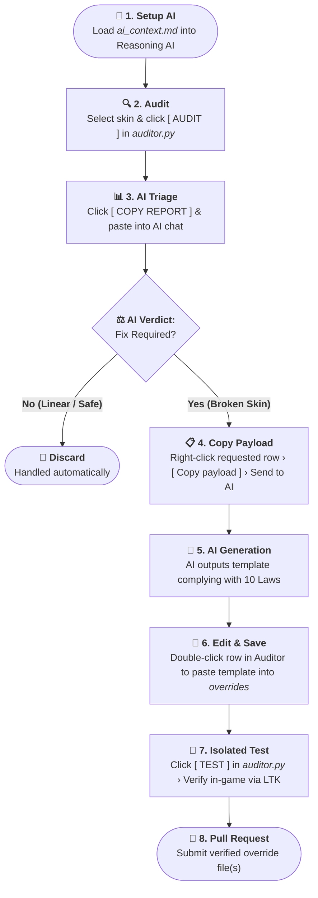

# Contributing to Vanilla True Builder

Thank you for your interest in contributing to **Vanilla True Builder (VTB)**.

VTB is an automated visual restoration engine for League of Legends. Over 95% of champion skins revert automatically via `main.py` without manual intervention. Contributions are strictly focused on curating the remaining edge cases (legendaries with unique state machines, decoupled deployable satellites, and submesh divergences) or refining the curation engine.

All skin curation in this project is executed through a specialized AI-assisted workflow combining the built-in Auditor studio (`auditor.py`), the forensic rulebook (`ai_context.md`), and any advanced reasoning AI (e.g., ChatGPT, Gemini, Claude, DeepSeek).

## Contribution Scopes

Contributions are accepted strictly within the following scopes:

1. **Curated Overrides (`overrides/`):** Property templates for problematic skins and combat satellites generated via the AI-assisted Auditor pipeline.
2. **Curation Logic & Laws (`ai_context.md`):** Proposals to optimize or expand the 10 Laws of Curation.

> [!NOTE]
> **Stability Baseline:** The 10 Laws of Curation have proven universally resilient in resolving model vanishing, weapon desynchronization, and animation locks with zero DirectX or client crashes. Any proposed changes to `ai_context.md` must preserve this stability standard.

## Mandatory AI-Assisted Curation Workflow

Contributors must follow the native AI curation loop before opening a Pull Request:



### Step 1: Initialize the AI
Open any reasoning AI chat and supply the contents of `ai_context.md` (located in the project root). This primes the model with the project's forensic constraints, memory structure rules, and the strict 10 Laws of Curation.

### Step 2: Extract Telemetry in the Auditor
Launch `auditor.py` (or click **`SKIN FIX`** in the top-right corner of the main builder). Select the target champion and skin, then click **`AUDIT`**. The Auditor autonomously decompiles and extracts strictly the relevant serialized properties (`PROP`) and 3D submeshes (`.skn`) into RAM without decompressing the multi-gigabyte game archive.

### Step 3: Forensic AI Triage
Click **`📋 COPY REPORT`** at the bottom of the Auditor and paste the diagnostics into your AI chat. The AI will evaluate whether divergences cause actual mechanical breakage or if they are linear forms already resolved automatically by `main.py` in 0ms (such as standard linear skins or skin-exclusive cosmetic forms severed by the base CAC reset).

### Step 4: Extract Specific Payload
If the AI confirms that an override template is required, it will identify the exact entity row (main champion body or satellite deployable). In the Auditor, right-click the requested row, select **`Copy payload`**, and send it to the AI.

### Step 5: AI Code Generation & Save
The AI will generate the property override adhering to the 10 Laws of Curation. Double-click that same row in the Auditor to open its corresponding file in `overrides/`, paste the AI-generated template, and save.

### Step 6: Isolated In-Game Test
Click the **`TEST`** button inside the Auditor. This compiles a standalone, isolated `.fantome` package for that specific champion and skin. Mount it in [LTK Manager](https://github.com/LeagueToolkit) and enter a match or Practice Tool to verify that models, submeshes, hitboxes, and spell effects render canonically without crashes or visual artifacts.

### Step 7: Submit Pull Request
Once verified in-game, commit strictly the final `.bin.txt` override file(s) and submit your Pull Request.

## Technical Quality Gates

Pull Requests failing any of these technical quality gates will be rejected:

* **Indentation:** Strictly tabs (`\t`). Spaces are rejected by the Ritobin parser grammar.
* **Base Parity (Law 7):** The `resourceMap` must be a pure 1:1 clone of `Skin0`. All target-skin exclusive keys, emotes, recalls, props, and dead branches (`0x00000000`) must be purged.
* **Zero External Binaries (Law 9):** Never commit binary files (`.skn`, `.dds`, `.wad`, `.exe`). 3D submesh discrepancies must be solved exclusively via Line 2 `# SUBMESH_ALIAS:` directives (patched in memory by the engine in 0ms).
* **Variant Declarations:** If parent skins cover chromas, declare them on Line 1 using `# VARIANTS: <IDs>` (e.g., `# VARIANTS: 20-27, 56`). Never generate duplicate templates for linear variants.
* **RAM Bridge (Law 1):** Deployable satellites must link both the satellite `.bin` and parent champion `.bin` so shared particle pointers resolve without engine errors.
* **No File Comments:** No `#` comments within the file body after the initial header directives (`# VARIANTS:` and `# SUBMESH_ALIAS:`).

## Pull Request Guidelines

1. **Atomic Commits:** Scope each PR to a single champion family (the main champion override and its associated combat satellites).
2. **Canonical Paths:** Place files strictly in the standard structure:
   ```text
   overrides/<entity>/skins/skin<id>.bin.txt
   ```
3. **Verification Proof:** State the target champion, skin ID, and brief confirmation that the fix was verified in-game via the Auditor **`TEST`** button.

## License

By contributing to Vanilla True Builder, you agree that your contributions will be licensed under the project's [GNU General Public License v3.0](LICENSE).
