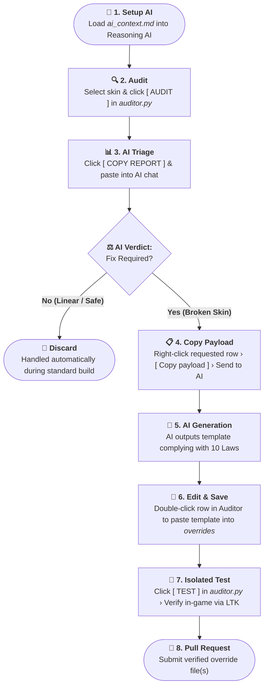

# Contributing to Vanilla True Builder

Thank you for your interest in contributing to **Vanilla True Builder (VTB)**.

Over 95% of champion skins revert automatically via `main.py` without manual intervention. Community contributions are strictly focused on curating the remaining edge cases: legendaries with complex state machines, decoupled deployable satellites, and submesh divergences.

All skin curation in this project is executed through the built-in Auditor studio (`auditor.py`) in combination with the curation rulebook (`ai_context.md`).

## Contribution Scopes

Contributions are accepted strictly within the following scopes:

1. **Curated Overrides (`overrides/`):** Plain-text property templates (`.bin.txt`) for problematic skins and combat satellites.
2. **Curation Rules (`ai_context.md`):** Proposals to optimize or expand the 10 Laws of Curation.

> [!NOTE]
> The 10 Laws of Curation have proven universally resilient in restoring broken skins with zero crashes. Any proposed changes to `ai_context.md` must be strictly non-redundant, proven necessary to achieve 100% game coverage, and represent a decisive rule that enabled the AI to fix a concrete broken skin.

## Mandatory Curation Workflow

Contributors must follow the native curation loop before opening a Pull Request:



### Step 1: Setup AI Chat
Provide the contents of `ai_context.md` (located in the project root) to your reasoning AI chat. This establishes the formatting constraints, memory structures, and the strict 10 Laws of Curation.

### Step 2: Run Diagnostics in the Auditor
Launch `auditor.py` (or click **`SKIN FIX`** in the main builder). Select the target champion and skin, then click **`AUDIT`**. The Auditor decompiles and extracts strictly the required properties (`PROP`) and 3D submeshes (`.skn`) into RAM.

### Step 3: Diagnostic Triage
Click **`📋 COPY REPORT`** at the bottom of the Auditor and paste the diagnostics into your AI chat. Discard items that `main.py` already resolves automatically (linear bodies, non-combat props, or cosmetic sub-forms without a native `Skin0`).

### Step 4: Extract Specific Payload
If an override template is required, identify the exact entity row (main champion body or satellite deployable). In the Auditor, right-click the requested row, select **`Copy payload`**, and send it to the AI.

### Step 5: Generate and Save Template
The AI will generate the property override adhering to the 10 Laws of Curation. Double-click that same row in the Auditor to open its corresponding file in `overrides/`, paste the template, and save.

### Step 6: Isolated In-Game Test
Click **`TEST`** inside the Auditor to compile an isolated `.fantome` package. Mount it in [LTK Manager](https://github.com/LeagueToolkit) and enter Practice Tool to verify that models, submeshes, hitboxes, and spell effects render correctly without crashes or visual artifacts.

### Step 7: Submit Pull Request
Once verified in-game, commit the generated `.bin.txt` file(s) strictly under `overrides/<entity>/skins/skin<id>.bin.txt` (preserving the exact entity structure created by the Auditor) and open your Pull Request.

## Pull Request Guidelines

1. **Focused PRs:** Scope each pull request to a single champion family (the main champion override and its combat satellites).
2. **Canonical Paths:** Place files strictly in the standard directory hierarchy:
   ```text
   overrides/<entity>/skins/skin<id>.bin.txt
   ```
3. **Verification Proof:** Mention the target champion, skin ID, and brief confirmation that the fix was verified in-game via the Auditor **`TEST`** button.
4. **Law Compliance:** Submitted templates must strictly adhere to the 10 Laws in `ai_context.md` (plain-text `.bin.txt` only, no binary files).

## License

By contributing to Vanilla True Builder, you agree that your contributions will be licensed under the project's [GNU General Public License v3.0](LICENSE).
