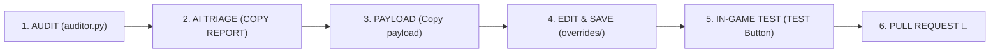

# Contributing to Vanilla True Builder

Thank you for your interest in contributing to **Vanilla True Builder (VTB)**.

VTB is an automated visual restoration engine for League of Legends. Over **95% of champion skins revert automatically** via `main.py` without manual intervention. Contributions are focused on curating the remaining edge cases (legendaries with unique state machines, decoupled deployable satellites, and submesh divergences) or refining curation laws.

## 🔍️ Contribution Scopes

Contributions are accepted within the following scopes:

1. **Curated Overrides (`overrides/`):** Property templates for edge-case skins and combat satellites using the native Auditor toolchain.
2. **Curation Logic & Laws (`ai_context.md`):** Proposals to improve the *10 Laws of Curation*.
   > **Stability Baseline:** The 10 Laws have proven universally resilient in resolving model vanishing, weapon desyncs, and animation locks with zero DirectX or client crashes. Proposed adjustments must maintain this stability standard.

## 🛂 Mandatory Curation Workflow

All skin overrides submitted to `overrides/` must follow the diagnostic pipeline before opening a Pull Request:



1. **Audit:** Select champion and skin in `auditor.py`, click **`AUDIT`**, and identify custom skeletons, animation controllers, or submesh discrepancies.
2. **Triage:** Click **`📋 COPY REPORT`** and evaluate against `ai_context.md` to confirm if a template is required. Discard linear champion bodies and skin-exclusive cosmetic forms.
3. **Draft:** If required, right-click the target row, select **`Copy payload`**, apply the 10 Laws using reasoning AI, and paste the template into the override file.
4. **Test:** Click **`TEST`** in `auditor.py` to compile an isolated `.fantome` package. Verify in-game via LTK Manager that animations, hitboxes, and geometry render canonically.
5. **Submit:** Commit strictly the validated `.bin.txt` file and submit a Pull Request.

## 🦺 Technical Quality Gates

Pull Requests failing any of these gates will not be merged:

* **Indentation:** Strictly **TABS (`\t`)**. Spaces are rejected by the Ritobin parser.
* **Base Parity (Law 7):** The `resourceMap` must be a 1:1 clone of `Skin0`. All target-skin exclusive keys, variant emotes, and dead branches (`0x00000000`) must be purged.
* **Zero External Binaries:** Do not commit binary files (`.skn`, `.dds`, `.wad`, `.exe`). Submesh divergences must use `# SUBMESH_ALIAS:` directives handled in memory by the engine.
* **Variant Declarations:** If parent skins cover chromas, declare them on Line 1 using `# VARIANTS: <IDs>`. Do not generate duplicate templates for linear variants.
* **RAM Bridge:** Deployable satellites must link both the satellite `.bin` and parent champion `.bin` so shared particle pointers resolve correctly.
* **No File Comments:** No `#` comments within the file body after the initial header directives.

## 🔀 Pull Request Guidelines

1. **Atomic Commits:** Scope each PR to a single champion family (main champion override and associated combat satellites).
2. **Canonical Paths:** Place files in the standard structure:
   ```text
   overrides/<entity>/skins/skin<id>.bin.txt
   ```
3. **Verification Note:** State the target champion, skin ID, and confirmation that the fix passed the Auditor `TEST` package in-game.

## 📄 License

By contributing to Vanilla True Builder, you agree that your contributions will be licensed under the project's [GNU General Public License v3.0](LICENSE).
