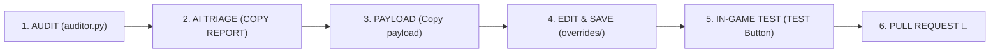

# 🤝 Contributing to Vanilla True Builder

Thank you for your interest in contributing to **Vanilla True Builder (VTB)**.

VTB is an automated, zero-bloat visual restoration engine for League of Legends. Over **95% of champion skins revert automatically** via `main.py` without manual intervention. Contributions are primarily focused on curating the remaining edge cases (legendaries with custom state machines, decoupled satellites/deployables, and submesh divergences) or refining the curation engine.

---

## 🔍️ Contribution Scopes

We welcome contributions strictly within these categories:

1. **Curated Overrides (`overrides/`):** Templates for problematic skins or deployable satellites using the native Auditor toolchain.
2. **Curation Logic & Laws (`ai_context.md`):** Proposed optimizations to the *10 Laws of Curation*.
   > **Note on Engine Stability:** The current 10 Laws have proven universally resilient in resolving model vanishing, weapon desyncs, and animation locks across all edge cases with **zero DirectX or client crashes**. Any proposed change to `ai_context.md` must preserve this 100% stability track record.

---

## 🛂 Mandatory Curation Workflow

All skin fixes submitted to `overrides/` **must follow the project's native diagnostic pipeline** before a Pull Request is opened:



1. **Audit:** Select the champion and skin in `auditor.py`, click **`AUDIT`**, and identify divergent state machines, custom rigs, or submesh contracts.
2. **Triage:** Click **`📋 COPY REPORT`** and analyze it against `ai_context.md` to confirm if an override is genuinely required (discard linear champion bodies and skin-exclusive cosmetic sub-forms).
3. **Draft Fix:** If required, right-click the requested entity row to **`Copy payload`**, apply the 10 Laws with reasoning AI, and paste the template into the override file.
4. **Isolated Test:** Click **`TEST`** inside `auditor.py` to compile an isolated `.fantome` package. Verify in-game with [LTK Manager](https://github.com/LeagueToolkit) that hitboxes, animations, and models render canonically without visual bugs.
5. **Submit:** Commit strictly the validated `.bin.txt` override file(s) and open your Pull Request.

---

## 🦺 Technical Quality Gates

Pull Requests that fail any of the following technical gates will be rejected:

* **Indentation:** Strictly **TABS (`\t`)**. Spaces are prohibited by the Ritobin parser.
* **Pure Base ResourceMap Parity (Law 7):** The `resourceMap` must be a **1:1 clone of `Skin0`**. All target-skin exclusive keys, emotes, recalls, and dead branches (`0x00000000`) must be purged.
* **Zero External Binaries:** **Never commit binary assets** (`.skn`, `.dds`, `.wad`, `.exe`). 3D submesh discrepancies must be solved exclusively via Line 2 `# SUBMESH_ALIAS:` directives (handled in memory by the engine in 0ms).
* **Variant Declarations:** If the parent skin covers chromas, declare them on Line 1 using `# VARIANTS: <IDs>` (e.g., `# VARIANTS: 20-27, 56`). Never create manual duplicate templates for linear chromas.
* **Literal RAM Bridge:** Satellite entities must link both the satellite `.bin` and parent champion `.bin` so shared base particle definitions resolve without errors.
* **Zero File-Body Comments:** No `#` comments within the file body after the initial header directives (`# VARIANTS:` and `# SUBMESH_ALIAS:`).

---

## 🔀 Pull Request Guidelines

1. **Atomic Commits:** Scope each PR to a single champion family (the champion override and its associated combat satellites).
2. **File Structure:** Place templates strictly in the canonical directory:
   ```text
   overrides/<entity>/skins/skin<id>.bin.txt
   ```
3. **PR Description:** State the champion, target skin ID, and brief verification details (e.g., *"Tested in-game via Auditor TEST button; resolved invisible weapon submesh on Skin 19"*).

---

## 📄 License
By contributing to Vanilla True Builder, you agree that your contributions will be licensed under the project's [GNU General Public License v3.0](LICENSE).
