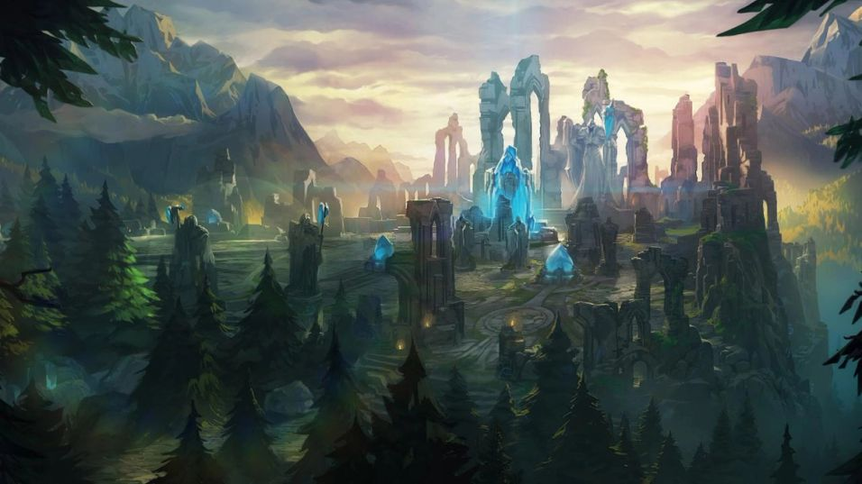
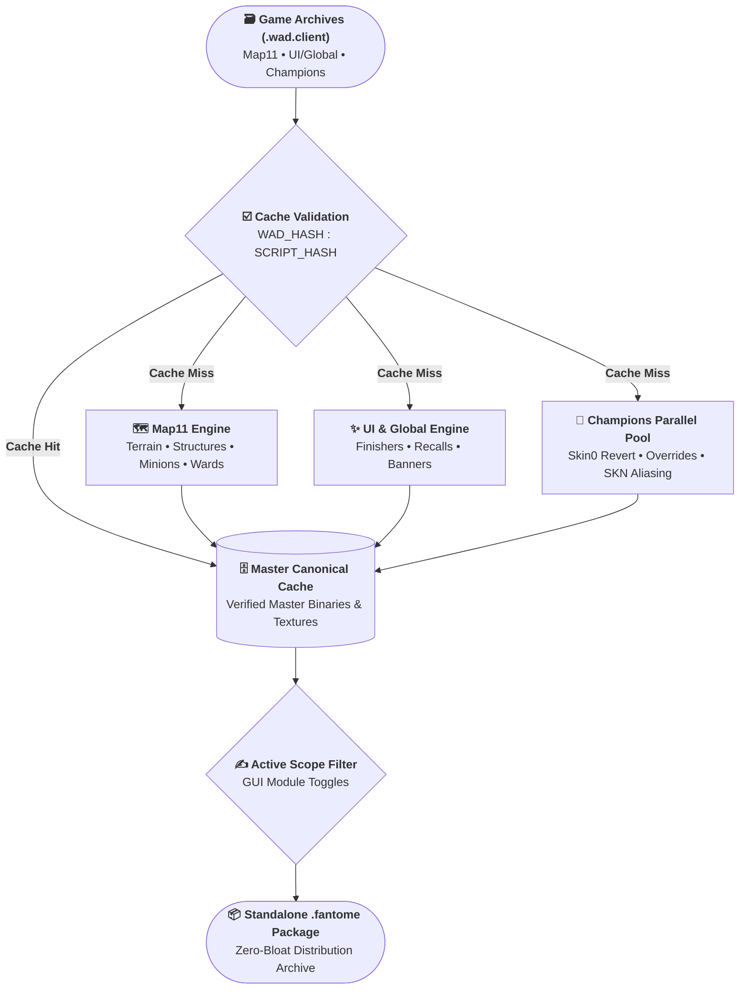

<div align="center">

# 🏛️ Vanilla True Builder

**The ultimate canonical Vanilla mod builder for [League of Legends](https://www.leagueoflegends.com) & [LTK Manager](https://github.com/LeagueToolkit).**  
*Build a pure, zero-bloat Vanilla mod `.fantome` in seconds.*

[](https://github.com/gsmeven/vanilla-true-builder/releases)
[](https://github.com/gsmeven/vtb-ltk-tools)
[](https://www.python.org/downloads/)
[](https://www.microsoft.com/windows)
[-785a28?style=for-the-badge&logo=zip&logoColor=white)](https://github.com/LeagueToolkit)
[](LICENSE)

[📖 Overview](#-overview) •
[📌 Setup](#-setup) •
[🛠️ For Developers](#️-for-developers-run-from-source) •
[🧰 Modules](#-modules) •
[⚙️ Core Technical](#️-core-technical) •
[🏗️ Architecture](#️-architecture) •
[🔬 Skin Curation](#-ai-skin-curation) •
[👥 Ecosystem & Credits](#-author--ecosystem)



</div>

## 📖 Overview

**Vanilla True Builder (VTB)** is an automated desktop mod generator engineered specifically for **[LTK Manager](https://github.com/LeagueToolkit)**. With a single click, it compiles a clean and custom base-grade restoration mod (`.fantome`) directly from your local game installation.

Traditional custom mods often rely on hacky placeholder textures, foreign dummy meshes, or destructive overrides that trigger DirectX crashes and hitbox desynchronization. Instead, VTB operates natively on official Riot archives using reverse-engineering toolchains [ritobin](https://github.com/LeagueToolkit/ritobin-tools) & [wadtools](https://github.com/LeagueToolkit/wadtools).

The engine performs surgical, in-place property patching, modifying strictly what is necessary and rebinding champion skins, Order and Chaos faction entities (structures, rubble, and minions), vision wards, Clash banners, and special recalls canonically to the game's own native Base definitions already compiled in your game. No third-party assets are ever imported: whenever an asset is strictly required to neutralize visual clutter, it is synthesized on the fly via raw hexadecimal bytecode (such as hardware-compliant 144-byte assets). This guarantees zero foreign bloat, flawless game stability, and a completely purified default experience.

> [!IMPORTANT]
> * **First-Time Build Duration:** The initial compilation takes a few minutes as VTB processes and sanitizes multiple WADs in parallel.
> * **Temporary Scratch Space:** Decompressed archives are processed in an isolated `%TEMP%` buffer without touching your game installation, and pruned automatically upon completion.
> * **LTK Game Overlay:** When patching **for the first time**, LTK Manager constructs a staged game overlay requiring **~21 GB of disk space** and takes a few minutes to finish. This initial duration and storage footprint are inherent characteristics of LTK's virtual filesystem.
> * **Hash Cache:** Validated via `WAD_HASH:SCRIPT_HASH`. Subsequent builds are near-instant, maintaining a compact local cache (**~1 GB**) of strictly necessary decompiled game files.
> * **Patch-Resilient:** Intelligent patch tracking monitors your root `.fantome` file against live game archives. You only need to run **`BUILD PACKAGE`** when prompted, updating altered files in seconds.
> * **AI Skin Curation:** Over **95% of champion skins revert automatically**. Edge cases with unique submeshes or animation conflicts can be resolved in under two minutes via the built-in Auditor (**`SKIN FIX`**) and reasoning AI.

## 📌 Setup

1. **Download the latest release:**  
   Download [`VanillaTrueBuilder.zip`](https://github.com/gsmeven/vanilla-true-builder/releases/latest) from the [Releases](https://github.com/gsmeven/vanilla-true-builder/releases) page.
2. **Extract archive:**  
   Extract the `.zip` to any folder on your computer.
3. **Launch:**  
   Double-click `VanillaTrueBuilder.exe`. *(The app automatically checks for updates and silently hot-swaps itself in seconds whenever a new version is released).*
4. **Build your restoration mod:**  
   Select the modules you wish to normalize (or click **Select All**) and press **`BUILD PACKAGE (.FANTOME)`**.
5. **Install into League of Legends:**  
   Click **`📁 OPEN FANTOME FOLDER`**, drag `VanillaTrueMod.fantome` into [**LTK Manager**](https://github.com/LeagueToolkit) and enable it!

> [!TIP]
> If any skin has model vanishing, submesh, or animation issues, you can curate it yourself in under 2 minutes.

### 🩺 How to Fix a Problematic Skin

1. Click **`SKIN FIX`** in the top-right corner of the main app to launch the **Auditor**.
2. Drag-and-drop, upload, or copy the contents of `ai_context.md` from your root folder.
3. Send it into any reasoning AI chat (e.g., Gemini, ChatGPT, DeepSeek).
4. Select the champion and skin, click **`AUDIT`**, then click **`📋 COPY REPORT`** at the bottom and paste it into the AI.
5. If the AI determines a fix is required:
    * Right-click the requested row to **`Copy payload`** and send it to the AI.
    * Double-click the row to open the override file, paste the AI-generated template, and save.
    * Click **`TEST`** inside the Auditor to compile and test an isolated `.fantome` package instantly!

### 🎛️ Recommended LTK Manager Setup 

* **Auto run:** `ON` *(Automatically launches LTK Manager when you start Windows)*
* **Start in tray unless update available:** `ON` *(Keeps LTK completely hidden in the system tray upon startup)*
* **Always start patcher at launch:** `ON` *(Automatically mounts and starts your active profile whenever the app launches)*

> [!NOTE]
> **"Unexplained Game Exit [GAME STOPPED]"** is a harmless cosmetic notice that occurs if your PC is shut down while the patcher was active without entering a match. 
> Ignore or simply click **Dismiss** and launch League normally (Your mod is completely functional).

## 🛠️ For Developers (Run from Source)

If you want to inspect, debug, or contribute to the Python codebase directly:

**Prerequisites:** Windows 10/11 x64 and [Python 3.10+](https://www.python.org/downloads/).

```powershell
# 1. Clone repository
git clone https://github.com/gsmeven/vanilla-true-builder.git
cd vanilla-true-builder

# 2. Launch Master Builder
python main.py

# 3. Launch Auditor directly
python auditor.py
```

> [!NOTE]
> On the first run from source, VTB will automatically connect to [vtb-ltk-tools](https://github.com/gsmeven/vtb-ltk-tools) to download verified binaries (`wadtools.exe`, `ritobin.exe`) and merge the latest CommunityDragon game hash dictionaries (`hashes.game.txt`).

## 🧰 Modules

Every restoration module can be toggled independently to match your restoration preferences:

| Module | Target Scope | Technical Implementation | Experience Expected |
| :--- | :--- | :--- | :--- |
| [**Champions**] | All champion skins | Rebinds animation graph to `Skin0`, clones base rig/mesh properties, resets CAC, and injects in-place submesh aliases. | Canonical base animations, uniform silhouettes, and original spell readability. |
| [**Structures**] | Turrets, Rubble, Inhibitors, Nexus, Shopkeepers | Reverts team structures to default Order/Chaos bases; preserves ARAM/Bilgewater logic through structural integrity filters. | Base structures with canonical models. |
| [**Minions**] | Melee, Ranged, Siege, and Super Minions | Re-indexes skin assignments to Faction IDs 0 and 1 without full map decompilation bloat. | Canonical minion silhouettes and wave readability. |
| [**Wards**] | Sight, Yellow Trinket, Control/Jammer, Blue Trinket | Re-maps ward skin hashes to default base models across all inventory items. | Default ward silhouettes with uniform, canonical models. |
| [**Map Accents**] | Clash banners, Worlds trophies, sponsor ads, godrays | Intercepts `mWorldParticlesINI`, neutralizes `StaticMaterialDef` diffuse passes, and assigns 144-byte assets. | Vanilla Rift with zero billboard clutter. |
| [**Nexus Finishers**] | Victory/Defeat cinematic overlays and audio banks | Clears `complexEmitterDefinitionData`, sets `m_Enabled = false`, and purges end-of-game audio banks in `UI.wad.client`. | Default victory/defeat screen pan across every match, without cinematic interruptions. |
| [**Special Recalls**] | Honor 5 & Challenger recall crests | Rewrites shared telemetry blocks in `Global.wad.client` to enforce canonical home recall VFX. | Classic recall VFX, no additional aura crests. |

## ⚙️ Core Technical

The pipeline operates directly on the game client's serialized property trees (`PROP`) and in-memory binary descriptors. Instead of importing external files or patching game logic, every character rig, animation controller, particle emitter, and faction asset is rebound to official Base definitions already compiled in the game archives. This preserves exact collision volumes, audio bank routing, and DirectX 11 pipeline stability without introducing foreign assets:

### 1. Binary Patch (`patch_skn_submesh_inplace`)
Certain legendary and mythic skins (e.g., True Damage Ekko) introduce divergent 3D submesh names in their `.skn` definitions. When spell scripts execute vanishing, visibility, or material shader callbacks (such as hiding a weapon mesh during cast animations or morph states), the rigid Base animation graph fails to locate the expected submesh string, causing invisible models or stuck geometry artifacts.

VTB resolves this entirely in memory without hosting or distributing external 3D models. The engine parses the native Riot `.skn` binary structure (`0x00112233` header), locates the target submesh within the 64-byte null-padded descriptor array, and patches the identifier in **0ms**:

```python
def patch_skn_submesh_inplace(base_skn_bytes: bytes, old_name: str, new_name: str) -> bytes:
    old_name_bytes = old_name.encode("utf-8")
    new_name_bytes = new_name.encode("utf-8")[:63]

    idx = base_skn_bytes.find(old_name_bytes + b"\x00")
    if idx == -1:
        idx = base_skn_bytes.find(old_name_bytes)
    if idx == -1:
        return base_skn_bytes

    new_name_padded = new_name_bytes + b"\x00" * (64 - len(new_name_bytes))
    patched = bytearray(base_skn_bytes)
    patched[idx : idx + 64] = new_name_padded
    return bytes(patched)
```

When an override in `overrides/` declares `# SUBMESH_ALIAS: <Base> -> <Target>`, the official Base `.skn` descriptor is cloned, aliased, and packed dynamically into the mod archive.

### 2. Shader & Particle Neutralization (`StaticMaterialDef` & `VfxSystemDefinitionData`)
Deleting material definitions or stripping particle systems directly from property files causes critical null-pointer dereferences in Riot's rendering engine and particle tick threads. Whenever visual clutter can be eliminated without external assets, VTB operates natively through surgical property manipulation:

* **Shader Alpha Discard (`StaticMaterialDef`):** Rather than binding dummy files, VTB preserves the native diffuse texture path to satisfy graphics driver pipeline contracts, but rewrites the pass parameters to force hardware alpha rejection:
  ```ritobin
  "Material_Identifier" = StaticMaterialDef {
      paramValues: list2[embed] = {
          StaticMaterialShaderParamDef {
              name: string = "AlphaTestValue"
              value: vec4 = { 2, 0, 0, 0 }
          }
      }
      shader: link = "Shaders/StaticMesh/DefaultEnv_Flat_AlphaTest"
  }
  ```
  Because normalized texture alpha channels are strictly bounded within [0.0, 1.0], all pixel fragments fail the alpha test stage unconditionally (1.0 < 2.0). Rasterization is immediately aborted at the hardware level prior to pixel shading, eliminating draw overhead completely without injecting any placeholder textures.
* **Particle Emitter Severing (`VfxSystemDefinitionData`):** Rather than deleting particle nodes referenced by spell scripts or ambient map triggers, VTB collapses emitter hierarchies into empty pointer arrays:
  ```ritobin
  "Vfx_Identifier" = VfxSystemDefinitionData {
      complexEmitterDefinitionData: list[pointer] = {}
      simpleEmitterDefinitionData: list[pointer] = {}
  }
  ```
  The particle subsystem evaluates zero active emitters, halting simulation loops, physics updates, and draw passes without breaking engine memory graphs.
* **Finisher Decoupling:** Silences Victory/Defeat cinematic interruptions by emptying `AudioBankPaths: list2[string] = {}`, setting `m_Enabled = false`, and redirecting UI override paths strictly back to baseline gameplay UX (`clientstates/gameplay/ux/endofgame/uibase`).

### 3. CAC Severing, Graph Reversion & Resource Parity
Rather than modifying spell logic, VTB operates on the game client's serialized property trees (`PROP`):
* **Contextual Action Data (CAC):** When `main.py` binds `mContextualActionData: link = "Characters/<Champion>/CAC/<Champion>_Base"`, runtime state machines controlling cosmetic multi-forms (e.g., Elementalist Lux, DJ Sona, Kayn stances) are severed at the root. The engine never instantiates cosmetic sub-entities.
* **Skin Graph Alignment:** Skeletons, meshes, textures, and scales are rebound 1:1 to Base `Skin0`, forcing `animationGraphData` to `"Characters/<Entity>/Animations/Skin0"`.
* **Base ResourceMap:** The `resourceMap` within `ResourceResolver` is cloned verbatim from `Skin0`. All target-skin exclusive combat variants, divergent recalls, emotes, and dead-branch hashes (`0x00000000`) are purged. The engine only ever queries native Base animation events, guaranteeing zero desynchronization.

### 4. 144-Byte BC3 Micro-Texture (`RAW_TRANSPARENT_TEX_BYTES`)
Deleting diffuse textures or substituting them with zero-byte files causes fatal DirectX swapchain crashes and GPU device removal errors (`DXGI_ERROR_DEVICE_REMOVED`) when pixel shaders sample unbound texture coordinates. 

VTB generates and injects an exact, hardware-compliant 144-byte DirectX 11 BC3/DXT5 transparent micro-texture (`4x4` texels, 1 mip level, uncompressed pitch 16 bytes):

```python
RAW_TRANSPARENT_TEX_BYTES = (
    b"DDS \x7c\x00\x00\x00\x07\x10\x08\x00\x04\x00\x00\x00\x04\x00\x00\x00"
    b"\x10\x00\x00\x00\x00\x00\x00\x00\x01\x00\x00\x00" + (b"\x00" * 44) +
    b"\x20\x00\x00\x00\x04\x00\x00\x00DXT5" + (b"\x00" * 20) +
    b"\x00\x10\x00\x00" + (b"\x00" * 16) + (b"\x00" * 16)
)
```

> [!NOTE]
> This asset is used only for auto-instantiated Clash banners/trophies and esports stage banners in `Global.wad.client`. Because the client automatically renders these assets if equipped by any player in the match, suppressing them safely requires a valid texture path. All other clutter is handled natively without external assets via shader alpha discard and particle severing (Item 2).

### 5. Cache Validator (`_is_cache_valid`)
VTB avoids redundant re-compilation across League patches via a dual-signature validation layer:

$$\text{Cache Validity} = (\text{WAD\_HASH} = \text{Current WAD}) \land (\text{SCRIPT\_HASH} = \text{Engine Fingerprint})$$

* **Archive Fingerprint:** Calculates a composite SHA-256 signature from the target WAD's resolved POSIX path, byte size, and nanosecond modification time (`st_mtime_ns`).
* **Pipeline Engine Fingerprint:** Truncated SHA-256 derived from `APP_VERSION`. If the VTB pipeline or submesh contract engine code updates, obsolete caches invalidate automatically.
* **Master Flat Storage:** Cached outputs are stored in flat directories (`cache/<wad_name>/.hash`), allowing unchanged archives to bypass extraction, decompilation, sanitization, and recompilation in **0ms**.

### 6. Dynamic Adapter (Rust & C++ Ritobin)
VTB natively bridges legacy and modern toolchains. Upon initialization, the engine probes `ritobin.exe --help` via `is_rust_ritobin()` to detect binary architecture:
* **Rust Toolchain:** Formulates CLI arguments using verb commands (`convert <in> -o <out> -t rito/bin -H <hashes>`).
* **Legacy C++ Toolchain:** Automatically switches to positional syntax (`-i bin/text -o text/bin -d <hashes> <in> <out>`).

This dynamic adapter prevents toolchain breakage across automated CI/CD updates and community forks.

### 7. Multi-Core Processing (`MAX_PARALLEL_WAD_JOBS`)
Processing over 160 champions and monolithic map archives sequentially would take hours. VTB leverages a multi-process architecture:
* **Dynamic Core Scaling:** Allocates CPU workers dynamically via `MAX_PARALLEL_WAD_JOBS = max(1, int(CPU_COUNT * 0.60))`, preventing system freezes while maximizing throughput.
* **Isolated Scratch Workspace:** All decompression and extraction tasks execute in a dedicated system `%TEMP%` buffer (`VanillaTrueTemp`) guarded by `atexit` and `SIGINT`/`SIGTERM` signal handlers.
* **Selective Regex Extraction:** Uses targeted regex filters (`-x` flag) in `wadtools` to decompress exclusively relevant skin `.bin` and `.skn` assets, bypassing gigabytes of animations, voiceovers, and soundbanks.

### 8. Toolchain CI/CD & Synchronization
VTB maintains its entire operational dependency stack autonomously without manual user intervention:
* **Self-Update ([`vanilla-true-builder`](https://github.com/gsmeven/vanilla-true-builder)):** When a newer application release is published on GitHub, VTB downloads the updated package in the background, renames the running process to `_old.exe`, moves the new binary into place, spawns the updated instance, and terminates the parent cleanly.
* **Toolchain ([`vtb-ltk-tools`](https://github.com/gsmeven/vtb-ltk-tools)):** Rather than bundling static, outdated binaries or requiring users to compile C++ and Rust toolchains locally, VTB synchronizes directly with a dedicated CI/CD repository that continuously tracks, builds, and distributes hardened 64-bit Windows binaries of `wadtools.exe` and `ritobin.exe` via automated release packages (`tools.zip`).
* **Synchronization:** Hash containers and tool archives are queried using HTTP conditional headers (`If-None-Match`). If upstream endpoints return HTTP `304 Not Modified`, redundant downloads, disk writes, and bandwidth consumption are eliminated in 0ms.
* **Hash Assembly:** Automatically detects, downloads, and merges segmented CommunityDragon hash streams (`hashes.game.txt.0`, `.1`, etc.) into a unified local hash container required for accurate asset-path resolution in `wadtools`.

### 9. Structural Integrity
Restoring structures and minions is not a simple "force Skin0" replacement. Naive mods that overwrite all structures with Skin 0 cause catastrophic visual bugs, such as Red (Chaos) turrets displaying Blue (Order) models, confusing players and ruining team readability.

VTB implements a surgical 4-way quadrant matching system combined with mathematical fallbacks:

```python
# Master 4-way structural quadrant assignment in main.py
if not is_chaos and not is_red:
    target_base_id = "0"  # Order Blue
elif not is_chaos and is_red:
    target_base_id = "1"  # Order Red
elif is_chaos and not is_red:
    target_base_id = "2"  # Chaos Blue
else:
    target_base_id = "3"  # Chaos Red
```

* **Property Parsing:** Inspects the internal binary property `championSkinName` for explicit team tags (`"chaos"`, `"order"`, `"red"`, `"blue"`). If omitted by Riot, it falls back to modulo arithmetic (`skin_id % 4` and `skin_id % 2`).
* **Rubble Alignment (`turretrubble`):** Rebinds destroyed turret rubble strictly to Order (`Skin 0`) or Chaos (`Skin 1`) bases, ensuring ground wreckage always reflects the correct team alignment.
* **Minion Faction:** Routes Melee, Ranged, Siege, and Super minions to canonical Faction 0 (Order) and Faction 1 (Chaos) baselines without corrupting alternate game tables.
* **Others Protection (`OTHER_INTEGRITY`):** Filters and isolates non-SR assets (`_ha`, `ha_`, `_bw`, `bw_`, `_aram`), guaranteeing that canonical structures as on ARAM (Howling Abyss) and Butcher's Bridge remain intact.

## 🏗️ Architecture



### `main.py` — Production Pipeline
* **Multiprocessing:** Parallel extraction and decompilation leveraging dynamic process pools scaled to system CPU limits (`MAX_PARALLEL_WAD_JOBS`).
* **Dynamic Adapter:** Dynamically probes `ritobin.exe` to detect whether it is running the legacy C++ toolchain or the bleeding-edge Rust port, dynamically adjusting argument flags.
* **Progress Scheduling:** Multi-phase weighted progress calculation across Map11, UI/Global, Champion batches, and `.fantome` packaging.
* **Hextech GUI:** Custom-styled, frameless Tkinter window with native Windows API interop (`ctypes.windll.user32`) providing smooth window dragging, snapping, minimize/maximize logic, and console telemetry.

### `auditor.py` — Skin Curation & Test
A suite for skin analysis and instant curation (AI assist):
* **Real Causality Filter:** Differentiates between benign linear models and real mechanical divergences.
* **Skin Diffing:** Flags custom rigs (`custom_skl`) and custom animation controllers (`custom_graph`).
* **Satellite Telemetry:** Discovers combat pets and deployables (`extraCharacterPreloads`), extracting persistent idle keys (`idleParticlesEffects`).
* **Variant Inheritance:** Scans raw binary structures via FNV-1a hash matching to resolve parent skin IDs without full decompile overhead.
* **Audit Report:** One-click **`COPY REPORT`** exports full champion family diagnostics directly to your clipboard for instant AI triage.
* **Payload Generator:** Right-click **`Copy payload`** generates standardized, ready-to-solve prompts with raw resolvers and Base graph parity.
* **Test Packaging:** Single-click **`TEST`** button compiles, validates, and packages isolated `.fantome` test archives for instant local testing in LTK Manager.

### `overrides/` — Curated Templates
A version-controlled directory of hand-crafted templates for legendary and ultimate skins requiring non-linear state machine handling (e.g., Blackfrost Anivia, True Damage Ekko). Includes pre-configured `# VARIANTS:` and `# SUBMESH_ALIAS:` headers.

## 🔬 AI Skin Curation

In traditional League of Legends modding, fixing broken animations, invisible models, or desynchronized spell meshes on complex legendary and ultimate skins required hours of manual reverse-engineering, hex-editing `.skn` headers, and inspecting memory structures.

**Vanilla True Builder automates this entire pipeline.** Through the built-in **Auditor (`SKIN FIX`)**, anyone, even without prior coding or 3D modeling experience, can curate and fix any skin in seconds by following the interactive **`HELP`** guide in the top toolbar.

### Autonomous Heavy Lifting
When you select a skin and click **`AUDIT`**, you do not need to touch raw files or decipher engine schemas. The Auditor autonomously executes:
* **Extraction:** Pulls exclusively the target skin binaries, Base `Skin0`, and `.skn` 3D geometry files in RAM without extracting or decompressing the entire multi-gigabyte champion archive.
* **Core Data:** Decompiles binary properties (`PROP`) and extracts canonical skeletons, animation graphs, persistent idle VFX keys, and satellite deployables (traps, turrets, pets).
* **3D Submesh Analysis:** Compares the target skin's 3D mesh descriptors against Base to identify visibility or weapon-vanishing discrepancies.
* **Audit Report (`COPY REPORT`):** Generates a full telemetry report across main champion bodies and deployable satellites for initial triage.
* **Payload Generation (`Copy payload`):** Extracts the raw resolver blocks, submesh alias directives, and canonical Base files for the selected row on demand.

The AI receives the exact, pristine baseline data it needs to write the fix, strictly adhering to the **10 Laws of Curation** to guarantee zero crashes, perfect hitboxes, and native visual stability.

<details>
<summary><b>Click to expand the 10 Laws for Curation</b></summary>

1. **LAW 1 (Literal RAM Bridge):** Copy 1:1 the `linked: list[string]` block exactly as declared in `Skin0` of the payload. For satellites, ensure both the satellite and parent champion `.bin` files are linked so cross-entity base particles resolve. Never invent paths.
2. **LAW 2 (Rig & Animation Graph):** Clone `skeleton`, `simpleSkin`, textures, and scale from `Skin0`. Point `animationGraphData` to `"Characters/<Entity>/Animations/Skin0"`.
3. **LAW 3 (CAC Reset):** Always inject `mContextualActionData: link = "Characters/<Champion>/CAC/<Champion>_Base"` to sever dynamic sub-form state machines at the root.
4. **LAW 4 (UI Integrity):** Clone from `Skin0` the blocks `loadscreen`, `iconCircle`, `iconSquare`, and `healthBarData` (`unitHealthBarStyle: u8 = 12`).
5. **LAW 5 (Audio Preservation):** Clone 1:1 the complete `skinAudioProperties` block from `Skin0` with all SFX and VO soundbanks (`.bnk` and `.wpk`).
6. **LAW 6 (Satellite Persistence):** For deployable satellites, inject into `SkinCharacterDataProperties`:
   ```ritobin
   idleParticlesEffects: list[embed] = {
       SkinCharacterDataProperties_CharacterIdleEffect {
           effectKey: hash = "<Persistent_Satellite_Effect>"
       }
   }
   ```
7. **LAW 7 (Canonical Base ResourceMap Parity):** The `resourceMap` block must be a **pure 1:1 clone of `Skin0`**. Discard all target-skin exclusive combat variants, emotes, recalls, jokes, props, and `0x00000000` keys.
8. **LAW 8 (Object Identifier):** Always declare `objectPath: hash = "Characters/<Entity>/Skins/<SkinID>"`.
9. **LAW 9 (The Submesh Contract & Geometric Aliasing):** If an audit report detects a **Submesh Contract Divergence**, Line 2 must declare:
   ```ritobin
   # SUBMESH_ALIAS: <Base_Submesh> -> <Target_Submesh>
   ```
10. **LAW 10 (Strict Type Grammar):** Ritobin is an intolerant C++ parser. Primitive vectors must strictly match their channel counts: `rgba` MUST contain exactly 4 integers `{ R, G, B, A }` (range 0..255). `vec4` has 4 floats, `vec3` has 3 floats, `vec2` has 2 floats. Never truncate values.

</details>

## 📦 Packaging & LTK Manager

The output package is assembled directly as a standard, distribution-ready `.fantome` archive tailored for [LTK Manager](https://github.com/LeagueToolkit):

```
VanillaTrueMod.fantome
├── META/
│   ├── info.json       # Mod metadata, versioning, author & details description
│   ├── README.md       # Overview, restoration checklist & dedications
│   ├── LICENSE         # Official GPL-3.0 License
│   ├── image.png       # High-resolution presentation banner
│   └── icon.png        # Square list thumbnail
└── WAD/
    ├── map11.wad.client/
    ├── ui.wad.client/
    ├── global.wad.client/
    └── <champion>.wad.client/
```

* **Details Tab:** Clean, concise description populated from `info.json` without broken markdown tags.
* **Readme Tab:** Displays the full overview, dynamic restoration status, and ecosystem dedications.
* **Licenses Tab:** Compatible with LTK's license viewer via standard `META/LICENSE`.

## ⌨️ Command Line Interface (CLI)

For headless builds, server setups, or continuous integration:

```powershell
# Standard headless build (all modules enabled)
python main.py

# Custom scoped build (e.g. skip finishers and recalls)
python main.py --no-finishers --no-recalls

# Force update CommunityDragon hash tables
python main.py --update-hashes

# Dry-run validation (executes pipeline without writing files to disk)
python main.py --dry-run
```

### CLI Arguments Reference

| Flag | Type | Description |
| :--- | :---: | :--- |
| `--gui` | `flag` | Force launch the Hextech graphical interface. |
| `--auditor` | `flag` | Launch the Champion Auditor & Curation Studio. |
| `--dry-run` | `flag` | Run simulation without modifying cache or writing `.fantome`. |
| `--update-hashes` | `flag` | Force re-download and merge of CommunityDragon hash containers. |
| `--workspace <dir>` | `path` | Explicitly specify workspace root folder. |
| `--map-wad <path>` | `path` | Explicit path to `Map11.wad.client`. |
| `--ui-wad <path>` | `path` | Explicit path to `UI.wad.client`. |
| `--no-champions` | `flag` | Skip champion skins restoration module. |
| `--no-structures` | `flag` | Skip structures (turrets, rubble, inhibs, nexus) module. |
| `--no-minions` | `flag` | Skip minions and super minions module. |
| `--no-wards` | `flag` | Skip vision wards and trinkets normalization module. |
| `--no-accents` | `flag` | Skip map accents, clash banners, and tournament statues module. |
| `--no-finishers` | `flag` | Skip nexus victory/defeat finisher neutralization module. |
| `--no-recalls` | `flag` | Skip special recalls (Honor, Challenger) module. |

## 👤 Author & Ecosystem

* [**Neve**](https://github.com/gsmeven) — Creator and lead maintainer of the Vanilla True ecosystem:
  * [**vanilla-true-builder**](https://github.com/gsmeven/vanilla-true-builder) — Master restoration engine and forensic auditor suite.
  * [**vtb-ltk-tools**](https://github.com/gsmeven/vtb-ltk-tools) — Continuous integration pipeline building and hosting bleeding-edge Windows binaries of `wadtools` and `ritobin`.

## 🌟 Acknowledgements & Dedications

This project stands on the shoulders of the true pioneers of the League of Legends reverse engineering and modding community:

* **[moonshadow565](https://github.com/moonshadow565)** — Creator of [**`ritobin`**](https://github.com/moonshadow565/ritobin) and [**`lolpytools`**](https://github.com/moonshadow565/lolpytools). The foundational genius behind mapping Riot's serialized property types (`PROP`) and enabling surgical, lossless `.bin` memory manipulation.
* **[Crauzer](https://github.com/Crauzer)** — Head of [**`LeagueToolkit`**](https://github.com/LeagueToolkit), [**`cslol-manager`**](https://github.com/LeagueToolkit/cslol-manager), and the underlying WAD toolchains. The architect who deciphered the `.wad.client` archive format and paved the way for modern LoL asset extraction.
* **[CommunityDragon](https://github.com/CommunityDragon)** — For the continuous open-source maintenance of game hash tables ([`hashes.game.txt`](https://github.com/CommunityDragon/Data)), bin hashes, and type registries.

## ⚖️ License & Disclaimers

* **License:** Distributed under the [GNU General Public License v3.0](LICENSE).
* **Security & Transparency:** Read our [Security & Anti-Virus Policy](SECURITY.md).
* **Legal Notice:** Read our full [Legal Disclaimer & Terms of Use](DISCLAIMER.md).
